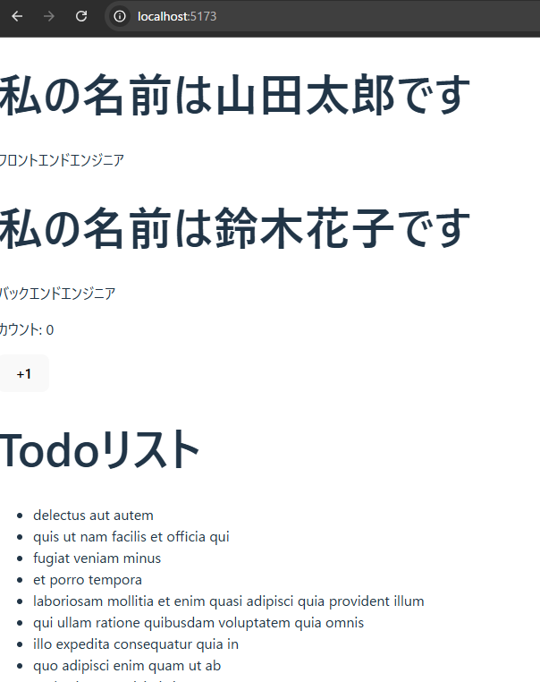

# Day10

Day9の課題、確認しました。
Propsを使ってコンポーネントを再利用する部分も、`useState`を使ってインタラクティブなカウンターを実装する部分も、両方とも完璧にできています！PropsとStateというReactの心臓部をしっかり理解されましたね。素晴らしいです！

それでは、第2週の山場、**Reactフック**の学習をさらに深めていきましょう。今日は、`useState`と並んで最も重要なフックの一つ、`useEffect`を学びます。

-----

### **【10日目】 Reactフック 〜useEffectで外部と連携する〜**

**本日のテーマ**:
Reactコンポーネントは、通常はPropsとStateに基づいてUIを描画（レンダリング）するだけの純粋な存在です。しかし、実際のアプリケーションでは、コンポーネントの描画とは直接関係ない処理、例えば「APIからデータを取得する」「タイマーをセットする」といった**副作用 (Side Effect)** を行いたい場面が頻繁にあります。この**副作用**を扱うためのフックが **`useEffect`** です。

-----

### **本日の達成目標**

1.  **`useEffect`** の役割が「コンポーネントのレンダリング後に副作用を実行するためのフック」であることを説明できる。
2.  `useEffect` の第2引数に空の配列 `[]` を渡すことで、「コンポーネントが最初に画面に表示された時に**一度だけ**処理を実行する」という使い方ができることを理解する。
3.  コンポーネントの表示時にAPIを叩き、取得したデータを **State** に保存して、画面に一覧表示できる。

-----

### **課題**

JSONPlaceholder APIから「Todoリスト」を取得し、画面にタイトルを一覧表示するコンポーネントを作成してください。

**要件：**

1.  **プロジェクトの準備**

      * Day9のプロジェクトをそのまま利用して構いません。`axios` がインストールされていない場合は、`npm install axios` で追加してください。

2.  **`TodoList.tsx` コンポーネントの新規作成**

      * `src/components` ディレクトリに `TodoList.tsx` という新しいファイルを作成します。
      * 内部に `TodoList` という関数コンポーネントを定義します。
      * APIから取得したTodoの配列を保存するための `todos` というStateを `useState` を使って定義してください。初期値は空の配列 `[]` です。
      * API通信中のローディング状態を管理するための `loading` というStateも定義しましょう。こちらは `boolean` 型で、初期値は `true` にします。

3.  **API通信の実装**

      * `useEffect` フックを使い、コンポーネントが最初にマウント（表示）された時に一度だけAPIリクエストが飛ぶように実装します。
      * APIエンドポイントは `https://jsonplaceholder.typicode.com/todos` です。
      * データの取得に成功したら、取得したTodoの配列を `todos` Stateに保存し、`loading` Stateを `false` に変更します。
      * データ取得に失敗した場合は、`console.error` でエラーを表示し、同様に `loading` Stateを `false` に変更します。

4.  **結果の表示**

      * `loading` が `true` の間は、「ローディング中...」というテキストを表示します。
      * `loading` が `false` になったら、`todos` Stateの配列を `map` メソッドで展開し、各Todoの `title` をリスト形式（`<ul>` と `<li>`）で表示してください。

5.  **`App.tsx` での表示**

      * 作成した `TodoList` コンポーネントを `App.tsx` にインポートし、表示してください。

**提出物:**
上記の要件を満たしたプロジェクト一式を、これまでと同じリポジトリの `day10` ブランチ、または `day10` ディレクトリなどに Push して、URL を教えてください。

-----

### **ヒント (動作確認済みのコード例)**

#### **1. Todoデータの型定義**

`TodoList.tsx` の中で、APIから受け取るデータの型をあらかじめ定義しておきましょう。

```typescript:src/components/todolist.tsx
// Todoオブジェクトの型
interface Todo {
  userId: number;
  id: number;
  title: string;
  completed: boolean;
}
```

#### **2. `useEffect` と `useState` を組み合わせたデータ取得の基本形**

```typescript:src/components/todolist.tsx
import { useState, useEffect } from 'react'; // useEffect をインポート
import axios from 'axios';

// (ここにTodoのinterface定義)

function TodoList() {
  // 1. Stateを定義
  const [todos, setTodos] = useState<Todo[]>([]); // Stateに型を指定
  const [loading, setLoading] = useState<boolean>(true);

  // 2. useEffectでコンポーネントのマウント時に処理を実行
  useEffect(() => {
    // useEffectのコールバック関数はasyncにできないので、中でasync関数を定義して呼び出す
    const fetchTodos = async () => {
      try {
        const response = await axios.get<Todo[]>('https://jsonplaceholder.typicode.com/todos');
        setTodos(response.data); // データをStateに保存
      } catch (error) {
        console.error('データの取得に失敗しました', error);
      } finally {
        setLoading(false); // 成功・失敗どちらでもローディングは終了
      }
    };

    fetchTodos();
  }, []); // 3. 第2引数に空配列を渡すことで、初回の一度だけ実行される

  // 4. ローディング状態に応じた表示の切り替え
  if (loading) {
    return <p>ローディング中...</p>;
  }

  // 5. データをリスト表示
  return (
    <div>
      <h1>Todoリスト</h1>
      <ul>
        {todos.map(todo => (
          <li key={todo.id}>{todo.title}</li>
        ))}
      </ul>
    </div>
  );
}

export default TodoList;
```

`useEffect` はReactの中でも少し癖があり、最初は難しく感じるかもしれませんが、これが使えるようになると作れるアプリケーションの幅が格段に広がります。頑張ってください！

# コードを書く時の考え方

### コーディングの思考プロセス

コードを書くとき、どこから始めればよいか迷うのはよくあることです。与えられた要件をただ書き写すのではなく、それを**論理的なステップ**に分解していくことが重要です。

以下に、提示された「Todoリスト」の課題に対する、私ならどのように考えるかという思考プロセスを順を追って解説します。これは、複雑な要件をシンプルに、そして漏れなく実装するための普遍的なアプローチです。

---

### 1. 全体像の把握と主要な構成要素の洗い出し

まず、要件全体を読んで、コンポーネントが何をする必要があるかを大まかに把握します。

-   **何を作るのか？**: 「Todoリスト」を表示するReactコンポーネント。
-   **データの出どころは？**: 外部のAPI（`https://jsonplaceholder.typicode.com/todos`）。
-   **コンポーネントの状態（State）は？**:
    -   APIから取得したTodoのリスト (`todos`)
    -   API通信中の状態 (`loading`)
-   **いつAPIを呼ぶのか？**: コンポーネントが**最初に表示された時**（マウント時）。
-   **どう表示するのか？**:
    -   ローディング中は「ローディング中...」というテキスト。
    -   データ取得後は、タイトルを`<ul>`と`<li>`で表示。

これらの要素を整理することで、頭の中でコンポーネントの骨格が明確になります。

### 2. コンポーネントの骨格を作成する

次に、洗い出した要素を基に、基本的なReactコンポーネントの骨格をコードで形にします。

-   **ファイルとコンポーネントの作成**: `src/components/TodoList.tsx`というファイルを作成し、`TodoList`という関数コンポーネントを定義します。
-   **必要なフックをインポート**: `useState`と`useEffect`は必須なので、最初にインポートします。
-   **Stateを定義**: 洗い出した2つのState (`todos`と`loading`) を`useState`で定義し、初期値を設定します。このとき、TypeScriptなので型（`<Todo[]>`や`<boolean>`）を忘れずに指定します。
-   **返り値（JSX）の基本形を定義**: 最終的に`return (...)`で何を返すのか、大枠のJSXを先に書いておきます。例えば、`<div><h1>Todoリスト</h1>...</div>`のように、外側の構造から考えます。

この段階では、まだロジックは実装しません。とにかく、骨組みを先に作ってしまうのがポイントです。

### 3. API通信のロジックを実装する

コンポーネントの骨格ができたら、次に核となる非同期通信のロジックを`useEffect`内に実装します。

-   **`useEffect`のセットアップ**: `useEffect(() => { ... }, []);`という形で、第2引数に空の配列（`[]`）を渡します。これにより、マウント時のみ実行されることを保証します。
-   **非同期関数の定義**: `useEffect`のコールバックは`async`にできないため、内部に`fetchTodos`のような非同期関数を定義し、それをすぐに呼び出します。
-   **API呼び出しとStateの更新**: `try/catch/finally`ブロックを使い、APIリクエストを投げます。
    -   `try`: 成功したら、`setTodos`でデータ(`response.data`)を保存し、`setLoading(false)`でローディングを終了します。
    -   `catch`: 失敗したら、エラーを`console.error`で表示し、`setLoading(false)`でローディングを終了します。
-   **axiosの型を適用**: `axios.get`の引数に`<Todo[]>`を指定することで、戻り値の型をTypeScriptに教えます。

### 4. 条件分岐とレンダリングの実装

最後に、API通信の結果に基づいて画面表示を切り替えるロジックを実装します。

-   **ローディング表示**: `return`文の前に`if (loading)`という条件分岐を置き、`true`の場合は「ローディング中...」を表示します。これにより、データがまだない状態でもユーザーに状況を伝えることができます。
-   **リストのレンダリング**: ローディングが`false`になったら、`todos.map()`を使ってリストをレンダリングします。各`<li>`には、`key`プロパティ（`todo.id`）を忘れずに追加します。

この順序で考えることで、一つの大きな要件を、小さな、管理しやすいタスクに分割し、それぞれを確実に実装していくことができます。このプロセスは、どんな規模のコーディング課題にも応用できます。

# interfaceの追加を判断するタイミング

APIからのレスポンスを扱う場合、**データの構造がわかった段階**で`interface`（または`type`）を定義します。これは、データの取得が成功するか失敗するかにかかわらず、APIが返すデータの「設計図」をコードに反映させるためです。

具体的な思考プロセスは以下のようになります。

### 1\. 外部データの構造を把握する

APIドキュメントを参照したり、実際にAPIにリクエストを送信してレスポンスを確認したりして、返されるデータの構造を把握します。

**今回の例でのレスポンスの構造**

```json
[
  {
    "id": 1,
    "name": "Leanne Graham",
    "username": "Bret",
    "email": "Sincere@april.biz",
    "address": { ... },
    ...
  },
  ...
]
```

このレスポンスは、「オブジェクトの配列」であることがわかります。

### 2\. データを使用する前に型定義を作成する

データの構造がわかったら、それを使用する**前に**`interface`を定義します。これにより、コード全体でそのデータの構造を共有し、型チェックの恩恵を受けられます。

**今回の例での`interface`定義**

```typescript
interface User {
  id: number;
  name: string;
  email: string;
}
```

このインターフェースは、APIレスポンスのすべてのプロパティを定義する必要はありません。**今回必要な`id`、`name`、`email`といった最小限のプロパティだけを定義する**のが一般的です。これにより、APIのレスポンスに変更があっても、テストコードが壊れにくくなります。

### 3\. API通信時に型定義を適用する

`axios.get()`のような非同期通信を行う際に、ジェネリクス（`<>`）を使って、取得するデータの型を明示します。

```typescript
// response.dataがUserの配列であることを指定
const response = await axios.get<User[]>(userAPI);

// これにより、response.dataがUser[]として扱われる
return response.data;
```

この時点で`response.data`は`any`型ではなく、`User[]`型として扱われるため、TypeScriptが型の整合性をチェックしてくれます。

### まとめ

`interface`は、APIからのデータなど、外部のデータソースを扱う際に**データの契約**として機能します。データを実際にコードで利用し始める前に定義することで、コーディング中のエラーを減らし、コードの堅牢性を高めることができます。


# result

